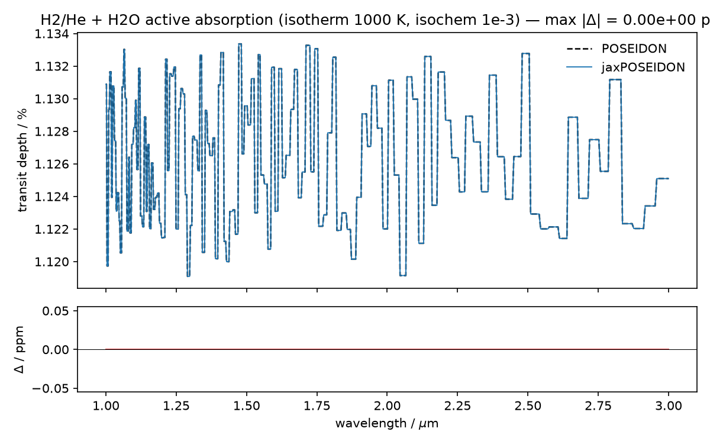
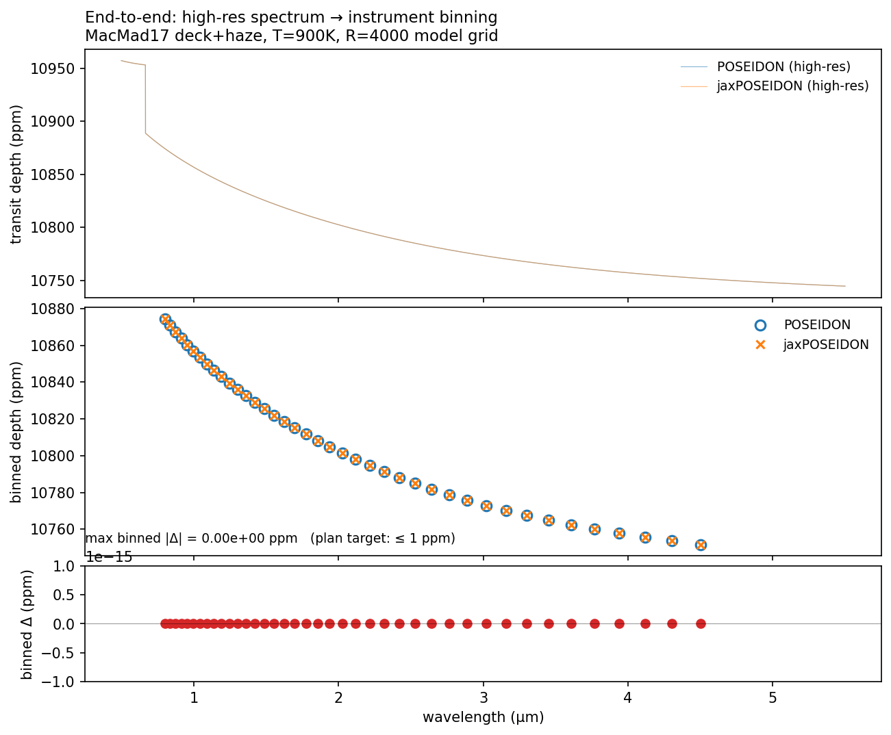
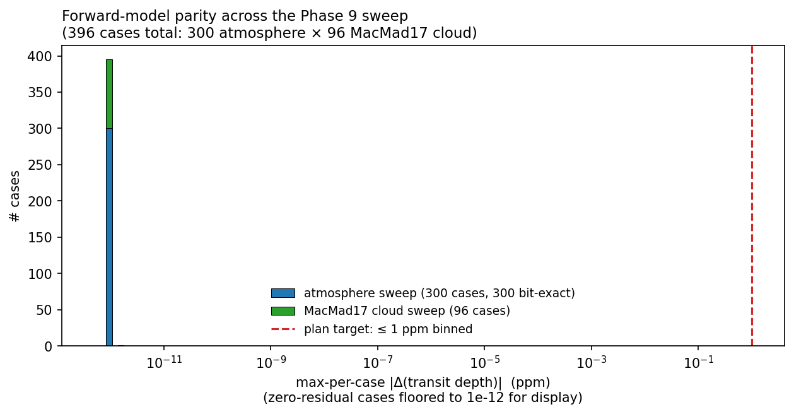
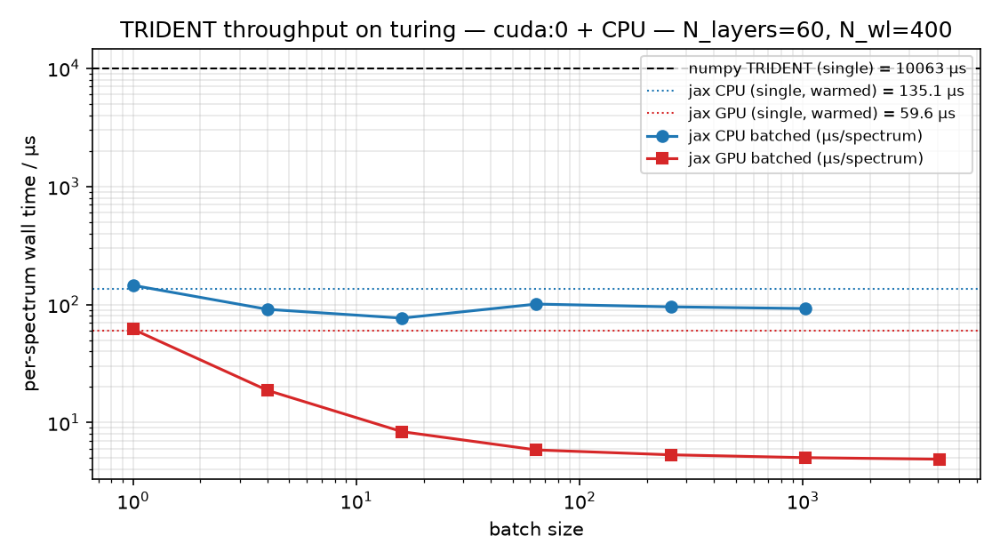

# jaxPOSEIDON

[](https://github.com/handley-lab/jaxPOSEIDON/actions/workflows/ci.yml)
[](https://opensource.org/licenses/BSD-3-Clause)

jaxPOSEIDON is an experimental JAX reimplementation of [POSEIDON](https://github.com/MartianColonist/POSEIDON)'s forward model components: opacity preprocessing, TRIDENT chord radiative transfer, MacMad17 cloud geometry and instrument convolution. POSEIDON was introduced by MacDonald & Madhusudhan (2017). It predates AURA, an independent code introduced by Pinhas et al. (2018). jaxPOSEIDON validates against POSEIDON across 1,744 tests at `atol=1e-15`, `rtol=1e-13`. It supports [BlackJAX nested slice sampling](https://github.com/handley-lab/blackjax) for differentiable, GPU-ready Bayesian inference.

## Usage

```python
import numpy as np
import jaxposeidon as jpo
from POSEIDON.core import (create_star, create_planet, define_model,
                            make_atmosphere, read_opacities,
                            wl_grid_constant_R)
from POSEIDON.constants import R_J, M_J, R_Sun

# Setup uses POSEIDON directly (create_star/planet/define_model/...).
star = create_star(R_Sun, 5000.0, 4.0, 0.0)
planet = create_planet("K2-18b-ish", R_J, mass=M_J, T_eq=900.0)
model = define_model("demo", ["H2", "He"], [], PT_profile="isotherm",
                     cloud_model="MacMad17", cloud_type="deck_haze")
P = np.logspace(2, -7, 100)
atm = make_atmosphere(planet, model, P, 10.0, R_J,
                       np.array([900.0]), np.array([]),
                       cloud_params=np.array([1.5, -2.0, -1.0]),
                       constant_gravity=True)
wl = wl_grid_constant_R(0.6, 5.0, 4000)
opac = read_opacities(model, wl, "opacity_sampling",
                      np.arange(700, 1110, 20), np.arange(-6, 2.2, 0.4),
                      testing=True)

# The hot path runs through jaxPOSEIDON.
spectrum = jpo.compute_spectrum(planet, star, model, atm, opac, wl)
ymodel  = jpo.bin_spectrum_to_data(spectrum, wl, data_properties)
loglike = jpo.loglikelihood(ymodel, ydata, err_data,
                             offsets_applied="single_dataset",
                             error_inflation="Line15+Piette20", ...)
```

POSEIDON setup (`create_star`, `create_planet`, `define_model`, `read_opacities`, `make_atmosphere`) is used as-is; the ported hot path is `compute_spectrum`, `bin_spectrum_to_data`, `loglikelihood`, `prior_transform`, `make_loglikelihood`, plus thin POSEIDON wrappers for `load_data` and `init_instrument`.

## Install

```bash
pip install git+https://github.com/handley-lab/jaxPOSEIDON
# POSEIDON itself is the canonical numerical oracle:
pip install git+https://github.com/MartianColonist/POSEIDON
# POSEIDON's opacity database (~70 GB; see POSEIDON docs for the download):
export POSEIDON_input_data=/path/to/POSEIDON_input_data
```

## Numerical validation

End-to-end `compute_spectrum` is validated on POSEIDON's full forward-model surface with 1,744 tests at `atol=1e-15, rtol=1e-13`, including a 396-case parametric sweep.

### Realistic transmission spectrum

The configuration uses an H2/He background, a 1000 K isotherm, isochemical H2O at 1e-3, 50 pressure layers, and R=500 over 1–3 µm through the standard opacity-sampling code path. It is analogous to [POSEIDON's first transmission tutorial](https://poseidon-retrievals.readthedocs.io/en/latest/content/notebooks/transmission_basic.html).



Max |residual| = 0 ppm across 549 wavelength points.

### Rayleigh + MacMad17 cloud geometry

Six H2/He Rayleigh / MacMad17 cloud configurations probe cloud geometry and instrument convolution specifically. They do not represent physical atmospheres with molecular absorption and do not provide exhaustive validation.


Spectral parity across the six Rayleigh / MacMad17 cloud configurations.



Parity after instrument convolution and binning.



Residual distribution across the 396-case parametric sweep.

Reproduce with `python scripts/generate_{molecular_validation_figure,parity_figures,binning_figure,sweep_histogram}.py` — the first requires POSEIDON installed (see `benchmarks/README.md`).

## Benchmarks

Benchmarks run on turing (NVIDIA RTX PRO 6000 Blackwell Max-Q); jax 0.12.0.1, jaxlib 0.12.0.1, Python 3.12.13, numpy 2.5.5. The workload uses N_layers=60, N_wl=400, repeats=20, and `block_until_ready`. The first call is measured separately as compile+run. Artefacts are in `benchmarks/`.

The benchmarked kernel is the real-JAX TRIDENT (`_jax_transmission.TRIDENT_kernel_jit`) added in PR #37. Geometry setup runs once in numpy outside the jit boundary and is not included in the per-spectrum cost.

| mode | batch | per-spectrum | speedup vs numpy single |
|---|---:|---:|---:|
| numpy single        |    1 | 10063 µs | 1.0× |
| jax CPU single      |    1 |   135.1 µs | 75× |
| jax CPU batch=16    |   16 |    76.7 µs | 131× |
| jax CPU batch=1024  | 1024 |    92.4 µs | 109× |
| jax GPU single      |    1 |    59.6 µs | 169× |
| jax GPU batch=16    |   16 |     8.4 µs | 1201× |
| jax GPU batch=256   |  256 |     5.3 µs | 1886× |
| jax GPU batch=4096  | 4096 |     4.9 µs | 2053× |

Most of the GPU speedup comes from batching with vmap over opacity inputs. Single-spectrum CPU jit alone gives ~75×. The headline ~2000× is only reached at batch=4096 on GPU.

The first-call compile+run cost is 34.7 ms on CPU and 7394 ms on GPU. This cost is amortised over subsequent calls with the same input shapes. Any sampler use needs the compile pattern reused across chain steps.

The per-spectrum cost excludes the numpy geometry setup (atmosphere construction + `setup_TRIDENT_geometry`), which runs once per parameter set. For a sampler closure that varies cloud morphology each step, that setup cost is in the loop.



Reproduce with `sbatch benchmarks/bench_turing.sbatch` on a Slurm GPU host; `python scripts/bench_trident.py --out <path>.json` for a single-host CPU-only run.

## Scope (v0.5)

v0.5 covers POSEIDON's full forward-model surface at numpy/scipy parity.
Setup uses POSEIDON's `create_star` / `create_planet` / `define_model` /
`make_atmosphere` / `read_opacities` (mirrored under `jaxposeidon._setup_api`
for callers who prefer to avoid `import POSEIDON` at runtime); the hot
path runs through jaxPOSEIDON.

Supported configurations:

- **`spectrum_type`**: `transmission`, `transmission_time_average`,
  `emission`, `dayside_emission`, `nightside_emission`, `direct_emission`.
- **`cloud_model`**: `cloud-free`, `MacMad17` (deck / haze / deck_haze,
  with `cloud_dim ∈ {1, 2}` patchy clouds), `Mie` (aerosol cross-section
  grid interpolation; see Iceberg note below).
- **`PT_profile`**: `isotherm`, `Madhu` (MS09), plus the v0.5 multi-knot
  / Pelletier / `PT_penalty` profiles wired through `_atmosphere.py`.
- **`X_profile`**: isochem free chemistry over POSEIDON's supported
  line-list species; FastChem equilibrium-chemistry grid interpolation
  via `_chemistry.py` + `_fastchem_grid_loader.py`.
- **Geometry**: 1D background plus 2D / 3D atmospheres
  (`PT_dim, X_dim ∈ {1, 2, 3}`) with Δ-mixing-ratio prior gating.
- **Opacities**: opacity-sampling (default) and **line-by-line** mode
  (`_lbl.py` + `_lbl_table_loader.py`); H- bound-free / free-free in
  `_h_minus.py`.
- **Instruments**: spectroscopic NIRSpec-style binning and photometric
  (IRAC etc.) dispatch via `_instrument_setup.py`.
- **Emission / reflection**: single-stream thermal emission with
  surface emissivity, Toon two-stream multiple-scattering emission and
  reflected-light branches (`_emission.py`).
- **Surfaces**: bare-surface coupling in emission with constant or
  lab-data albedos (multi-component) via `_surface_setup.py`.
- **Stellar contamination**: Rackham+17/18 single-spot and multi-region
  factors with pysynphot / PyMSG grid loaders (`_stellar.py` +
  `_stellar_grid_loader.py`).
- **High-resolution**: airtovac / vactoair, sysrem, data-prep,
  Doppler / rotation kernel, CCF surface (`_high_res.py`).
- **Contributions**: per-species spectral and per-layer pressure
  contribution kernels (`_contributions.py`).
- **Likelihood / priors**: Gaussian likelihood with optional offsets and
  Line15 / Piette20 error inflation; uniform / Gaussian / sine / CLR
  mixing-ratio priors and `PT_penalty` regularisation.

### POSEIDON-oracle absences (NOT jaxPOSEIDON deferrals)

POSEIDON open-source at the cloned commit does **not** ship an `Iceberg`
cloud model — the kwarg is exposed at POSEIDON's public API but the
runtime branch is absent. jaxPOSEIDON accordingly rejects
`opaque_Iceberg=True` with `NotImplementedError`; there is no POSEIDON
output to match.

### Deferred to v1

- JAX-traceable forward model and full `jax.grad` parity (the v0.5
  hot path is faithful numpy/scipy; tracing migration is the v1 step
  that unlocks BlackJAX NSS execution).
- `loglikelihood_PCA` / `loglikelihood_sysrem` / `loglikelihood_high_res`
  closures (high-res data-prep + CCF surface are ported; the retrieval
  closures wrapping them are the 0.5.16b2 follow-up).
- Live BlackJAX NSS sampler execution and the K2-18b retrieval run.
- eddysed runtime integration with the forward model (loader is in
  `_eddysed_input_loader.py`; runtime wiring is the 0.5.14 follow-up).

## Running the tests

```bash
git clone https://github.com/MartianColonist/POSEIDON
PYTHONPATH=.:./POSEIDON pip install -e ".[dev]"
PYTHONPATH=.:./POSEIDON pytest tests/
```

Synthetic CIA / opacity HDF5 fixtures are built in-tempdir per-test, so the full 70 GB opacity database is **not** required for CI; only the molecular-opacity end-to-end test builds a synthetic `Opacity_database_v1.3.hdf5` with a single H2O group.

## How this library was generated

jaxPOSEIDON was produced in a single AI-assisted [Claude Code](https://www.anthropic.com/claude-code) session using a reference-guided-translation workflow: POSEIDON is the numerical oracle, every test asserts equivalence against POSEIDON, and implementation proceeded phase-by-phase with adversarial external-LLM review (`mcp__llm__review`) against the plan and the POSEIDON source after every phase. The same workflow was first demonstrated with [jaxwavelets](https://github.com/handley-lab/jaxwavelets). The full account — what worked, what required human judgment, what the agent did badly and how it was caught — is in [`CASE_STUDY.md`](CASE_STUDY.md).

## Acknowledgements

jaxPOSEIDON extends [POSEIDON](https://github.com/MartianColonist/POSEIDON) (Ryan J. MacDonald, 2022, BSD-3). POSEIDON provides the numerical reference implementation, the opacity database schema, and the instrument reference data used for validation and runtime setup.

## License

BSD-3-Clause, matching POSEIDON. Will Handley, Institute of Astronomy, Cambridge (2026).
