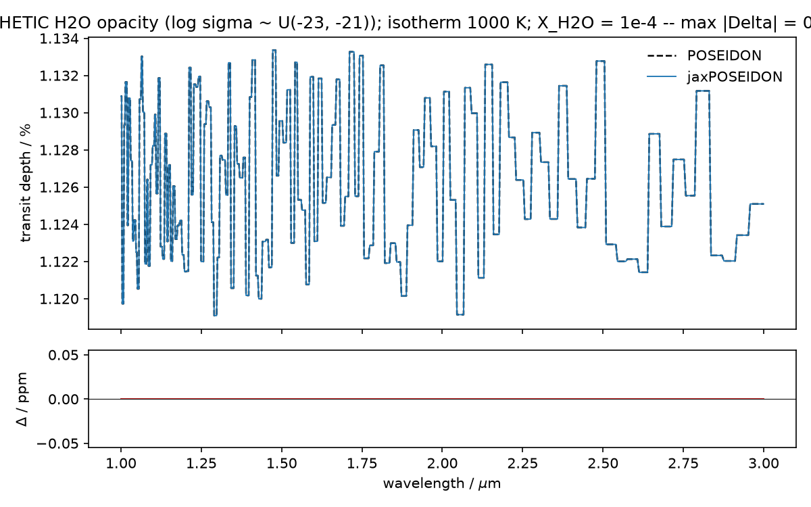
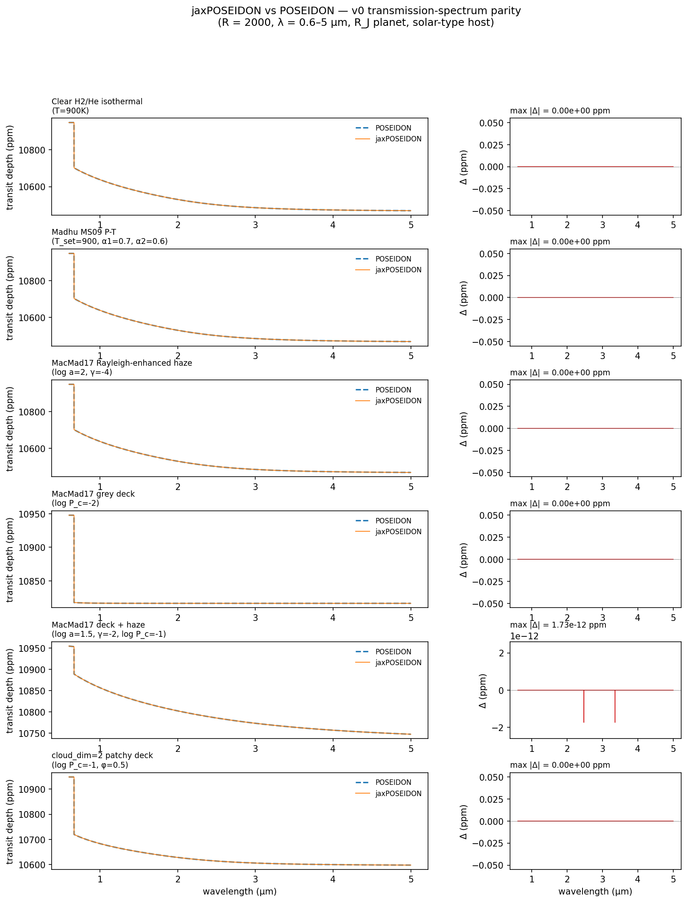

# jaxPOSEIDON

[](https://github.com/handley-lab/jaxPOSEIDON/actions/workflows/ci.yml)
[](https://opensource.org/licenses/BSD-3-Clause)

jaxPOSEIDON is an experimental JAX reimplementation of [POSEIDON](https://github.com/MartianColonist/POSEIDON)'s forward model components: opacity preprocessing, TRIDENT chord radiative transfer, MacMad17 cloud geometry and instrument convolution. POSEIDON was introduced by MacDonald & Madhusudhan (2017). It predates AURA, an independent code introduced by Pinhas et al. (2018). jaxPOSEIDON validates against POSEIDON across 1,744 tests at `atol=1e-15`, `rtol=1e-13`. It supports [BlackJAX nested slice sampling](https://github.com/handley-lab/blackjax) for differentiable, GPU-ready Bayesian inference.

## Usage

```python
import numpy as np
import jaxposeidon as jpo
from POSEIDON.core import (create_star, create_planet, define_model,
                            make_atmosphere, read_opacities,
                            wl_grid_constant_R)
from POSEIDON.constants import R_J, M_J, R_Sun

# Setup uses POSEIDON directly (create_star/planet/define_model/...).
star = create_star(R_Sun, 5000.0, 4.0, 0.0)
planet = create_planet("K2-18b-ish", R_J, mass=M_J, T_eq=900.0)
model = define_model("demo", ["H2", "He"], [], PT_profile="isotherm",
                     cloud_model="MacMad17", cloud_type="deck_haze")
P = np.logspace(2, -7, 100)
atm = make_atmosphere(planet, model, P, 10.0, R_J,
                       np.array([900.0]), np.array([]),
                       cloud_params=np.array([1.5, -2.0, -1.0]),
                       constant_gravity=True)
wl = wl_grid_constant_R(0.6, 5.0, 4000)
opac = read_opacities(model, wl, "opacity_sampling",
                      np.arange(700, 1110, 20), np.arange(-6, 2.2, 0.4),
                      testing=True)

# The hot path runs through jaxPOSEIDON.
spectrum = jpo.compute_spectrum(planet, star, model, atm, opac, wl)
ymodel  = jpo.bin_spectrum_to_data(spectrum, wl, data_properties)
loglike = jpo.loglikelihood(ymodel, ydata, err_data,
                             offsets_applied="single_dataset",
                             error_inflation="Line15+Piette20", ...)
```

POSEIDON setup (`create_star`, `create_planet`, `define_model`, `read_opacities`, `make_atmosphere`) is used as-is; the ported hot path is `compute_spectrum`, `bin_spectrum_to_data`, `loglikelihood`, `prior_transform`, `make_loglikelihood`, plus thin POSEIDON wrappers for `load_data` and `init_instrument`.

## Install

```bash
pip install git+https://github.com/handley-lab/jaxPOSEIDON
# POSEIDON itself is the canonical numerical oracle:
pip install git+https://github.com/MartianColonist/POSEIDON
# POSEIDON's opacity database (~70 GB; see POSEIDON docs for the download):
export POSEIDON_input_data=/path/to/POSEIDON_input_data
```

## Numerical validation

End-to-end `compute_spectrum` is validated on POSEIDON's full forward-model surface with 1,744 tests at `atol=1e-15, rtol=1e-13`, including a 396-case parametric sweep.

### Synthetic active-species parity

This compares `jaxposeidon.compute_spectrum` against upstream `POSEIDON.core.compute_spectrum` on an H2/He background with H2O as an active species through the opacity-sampling code path.

**The H2O cross section is synthetic**: `log10(sigma)` is sampled IID from `U(-23, -21)` on the `(nu, logP, T)` grid. It is not a HITRAN / HITEMP / ExoMol line list and does not reproduce POSEIDON's introductory transmission example.

The configuration uses a 1000 K isotherm, isochem `X_H2O = 1e-4` (`log10 = -4.0`), 50 pressure layers, and R=500 over 1–3 µm. Full provenance (grid ranges, random seed, IID distribution, atmospheric and wavelength settings, and parity measurements) is in `benchmarks/synthetic_opacity_provenance.json`.



Max |residual| = 0 ppm across 549 wavelength points.

This confirms the opacity-sampling data path end-to-end; it is not evidence of parity on a realistic molecular line list. A real-opacity validation needs the POSEIDON opacity database staged at `POSEIDON_input_data` and is not in this PR.

### Rayleigh + MacMad17 cloud geometry

Six H2/He Rayleigh / MacMad17 cloud configurations probe cloud geometry and instrument convolution specifically. They do not represent physical atmospheres with molecular absorption and do not provide exhaustive validation.



Spectral parity across the six Rayleigh / MacMad17 cloud configurations.


Parity after instrument convolution and binning.


Residual distribution across the 396-case parametric sweep.

Reproduce with `python scripts/generate_{synthetic_opacity_parity_figure,parity_figures,binning_figure,sweep_histogram}.py` — the first requires POSEIDON installed (see `benchmarks/README.md`).

## Benchmarks

Measurements run on turing in the Slurm `gpu` partition with 1× NVIDIA RTX PRO 6000 Blackwell Max-Q. The environment uses jax 0.12.0.1, jaxlib 0.12.0.1, Python 3.12.13 and numpy 2.5.5.

The workload has `N_layers = 60` and `N_wl = 400`, with 20 repeats for the GPU run and 10 for the CPU run. Each JAX call is followed by `block_until_ready()`. The first call is recorded separately as compile+run.

The baselines use matched boundaries:

- `poseidon_e2e`: upstream `POSEIDON.transmission.TRIDENT` (numba-JIT) on CPU, end-to-end including geometry setup. This is the code upstream ships.
- `numpy_e2e`: `jaxposeidon._transmission.TRIDENT`, the local numpy port, end-to-end including geometry setup. It is a self-consistency check only, not representative of production POSEIDON, which uses numba.
- `jax_e2e`: numpy `setup_TRIDENT_geometry` followed by JAX `TRIDENT_kernel_jit` with `block_until_ready()`. Geometry is recomputed each call, representing a sampler where cloud morphology varies.
- `jax_kernel`: the JAX kernel only, with geometry precomputed once outside the timer, representing a sampler with fixed geometry (constant cloud / varying PT / X).

Each batch element has unique random `kappa_clear` / `kappa_cloud` arrays; batches do not broadcast an identical spectrum. Comparing `jax_kernel` with `poseidon_e2e` for a single spectrum gives `max |residual| = 0.000e+00 ppm`, bit-exact in float64.

### CPU results

Times are µs per spectrum, reported as medians over 10 repeats on turing with `--cpus-per-task=4` and `JAX_PLATFORMS=cpu`.

| batch | poseidon_e2e | numpy_e2e | jax_e2e | jax_kernel |
|---:|---:|---:|---:|---:|
| 1 | — (warmup noise) | 11 501 | 6 667 | 156 |
| 4 | 280 | 10 098 | 1 794 | 97 |
| 16 | 285 | 10 128 | 509 | 89 |
| 64 | 278 | 10 253 | 201 | 115 |
| 256 | skipped | skipped | 126 | 97 |
| 1024 | skipped | skipped | 102 | 99 |

### GPU results

Times are µs per spectrum, reported as medians over 20 repeats on turing with `--gres=gpu:1`. The `poseidon_e2e` and `numpy_e2e` references run on the host CPU of the same node.

| batch | poseidon_e2e (CPU) | numpy_e2e (CPU) | jax_e2e (GPU) | jax_kernel (GPU) |
|---:|---:|---:|---:|---:|
| 1 | 331 | 11 533 | 7 485 | 77.2 |
| 4 | 295 | 10 200 | 1 800 | 25.5 |
| 16 | 290 | 10 277 | 472 | 9.9 |
| 64 | 293 | 10 179 | 123 | 6.6 |
| 256 | skipped | skipped | 34.6 | 5.4 |
| 1024 | skipped | skipped | 12.5 | 5.2 |
| 4096 | skipped | skipped | 6.9 | 5.1 |

### Compile and first-call costs

First-call costs are recorded separately and amortised across subsequent calls with the same shapes.

- CPU `jax_e2e`: approximately 70 ms; CPU `jax_kernel`: approximately 50 ms.
- GPU `jax_e2e`: approximately 13.8 s (XLA compile); GPU `jax_kernel`: approximately 130 ms.
- POSEIDON numba warmup: approximately 0.5–20 ms depending on batch; numba caches after warmup.

### Interpretation

The throughput advantage is in the kernel-only measurement. At batch = 4096, GPU `jax_kernel` takes 5.1 µs per spectrum, compared with approximately 293 µs per spectrum for upstream POSEIDON on CPU: approximately 57× higher throughput for the sampler pattern where geometry is fixed and only opacity varies between steps.

At batch = 1, recomputing geometry each call makes GPU `jax_e2e` slower than upstream POSEIDON on CPU (7.5 ms versus 0.33 ms). GPU execution wins only when the kernel work is large enough to pay for device transfers; batching is the intended inference pattern.

The numpy port is approximately 35× slower than upstream POSEIDON at batch = 16 because upstream uses numba. `numpy_e2e` serves as a self-consistency reference, not a substitute for the upstream baseline. The `jax_kernel` output matches `poseidon_e2e` at bit-level precision in float64, with max |residual| = 0 ppm on the compared batch element.

### Reproducing

- Slurm: `sbatch benchmarks/bench_turing.sbatch` runs CPU then GPU, using 10 CPU repeats and 20 GPU repeats. Both pass `--numpy-max-batch 64` to avoid the slow numpy-port baseline on large batches.
- One-off: `python scripts/bench_trident.py --out run.json --repeats 20 --batches 1 4 16 64 256 1024 --numpy-max-batch 64`. Set `JAX_PLATFORMS=cpu` to force CPU execution.
- Raw results: `benchmarks/bench_turing_cpu.json` and `benchmarks/bench_turing_gpu.json`; full Slurm log: `benchmarks/slurm-7469.out`.
- The `jax_e2e` timings depend on hitting the jit cache: the benchmark hoists the jit outside the per-call closure. Re-creating the jit each call incurs compilation at every step.

The production headline is kernel-only batched throughput on GPU; end-to-end execution with per-call geometry recomputation shows no GPU win at batch = 1 and begins paying off around batch = 16, while upstream POSEIDON remains the appropriate single-spectrum CPU baseline.
## Scope (v0.5)

v0.5 covers POSEIDON's full forward-model surface at numpy/scipy parity.
Setup uses POSEIDON's `create_star` / `create_planet` / `define_model` /
`make_atmosphere` / `read_opacities` (mirrored under `jaxposeidon._setup_api`
for callers who prefer to avoid `import POSEIDON` at runtime); the hot
path runs through jaxPOSEIDON.

Supported configurations:

- **`spectrum_type`**: `transmission`, `transmission_time_average`,
  `emission`, `dayside_emission`, `nightside_emission`, `direct_emission`.
- **`cloud_model`**: `cloud-free`, `MacMad17` (deck / haze / deck_haze,
  with `cloud_dim ∈ {1, 2}` patchy clouds), `Mie` (aerosol cross-section
  grid interpolation; see Iceberg note below).
- **`PT_profile`**: `isotherm`, `Madhu` (MS09), plus the v0.5 multi-knot
  / Pelletier / `PT_penalty` profiles wired through `_atmosphere.py`.
- **`X_profile`**: isochem free chemistry over POSEIDON's supported
  line-list species; FastChem equilibrium-chemistry grid interpolation
  via `_chemistry.py` + `_fastchem_grid_loader.py`.
- **Geometry**: 1D background plus 2D / 3D atmospheres
  (`PT_dim, X_dim ∈ {1, 2, 3}`) with Δ-mixing-ratio prior gating.
- **Opacities**: opacity-sampling (default) and **line-by-line** mode
  (`_lbl.py` + `_lbl_table_loader.py`); H- bound-free / free-free in
  `_h_minus.py`.
- **Instruments**: spectroscopic NIRSpec-style binning and photometric
  (IRAC etc.) dispatch via `_instrument_setup.py`.
- **Emission / reflection**: single-stream thermal emission with
  surface emissivity, Toon two-stream multiple-scattering emission and
  reflected-light branches (`_emission.py`).
- **Surfaces**: bare-surface coupling in emission with constant or
  lab-data albedos (multi-component) via `_surface_setup.py`.
- **Stellar contamination**: Rackham+17/18 single-spot and multi-region
  factors with pysynphot / PyMSG grid loaders (`_stellar.py` +
  `_stellar_grid_loader.py`).
- **High-resolution**: airtovac / vactoair, sysrem, data-prep,
  Doppler / rotation kernel, CCF surface (`_high_res.py`).
- **Contributions**: per-species spectral and per-layer pressure
  contribution kernels (`_contributions.py`).
- **Likelihood / priors**: Gaussian likelihood with optional offsets and
  Line15 / Piette20 error inflation; uniform / Gaussian / sine / CLR
  mixing-ratio priors and `PT_penalty` regularisation.

### POSEIDON-oracle absences (NOT jaxPOSEIDON deferrals)

POSEIDON open-source at the cloned commit does **not** ship an `Iceberg`
cloud model — the kwarg is exposed at POSEIDON's public API but the
runtime branch is absent. jaxPOSEIDON accordingly rejects
`opaque_Iceberg=True` with `NotImplementedError`; there is no POSEIDON
output to match.

### Deferred to v1

- JAX-traceable forward model and full `jax.grad` parity (the v0.5
  hot path is faithful numpy/scipy; tracing migration is the v1 step
  that unlocks BlackJAX NSS execution).
- `loglikelihood_PCA` / `loglikelihood_sysrem` / `loglikelihood_high_res`
  closures (high-res data-prep + CCF surface are ported; the retrieval
  closures wrapping them are the 0.5.16b2 follow-up).
- Live BlackJAX NSS sampler execution and the K2-18b retrieval run.
- eddysed runtime integration with the forward model (loader is in
  `_eddysed_input_loader.py`; runtime wiring is the 0.5.14 follow-up).

## Running the tests

```bash
git clone https://github.com/MartianColonist/POSEIDON
PYTHONPATH=.:./POSEIDON pip install -e ".[dev]"
PYTHONPATH=.:./POSEIDON pytest tests/
```

Synthetic CIA / opacity HDF5 fixtures are built in-tempdir per-test, so the full 70 GB opacity database is **not** required for CI; only the molecular-opacity end-to-end test builds a synthetic `Opacity_database_v1.3.hdf5` with a single H2O group.

## How this library was generated

jaxPOSEIDON was produced in a single AI-assisted [Claude Code](https://www.anthropic.com/claude-code) session using a reference-guided-translation workflow: POSEIDON is the numerical oracle, every test asserts equivalence against POSEIDON, and implementation proceeded phase-by-phase with adversarial external-LLM review (`mcp__llm__review`) against the plan and the POSEIDON source after every phase. The same workflow was first demonstrated with [jaxwavelets](https://github.com/handley-lab/jaxwavelets). The full account — what worked, what required human judgment, what the agent did badly and how it was caught — is in [`CASE_STUDY.md`](CASE_STUDY.md).

## Acknowledgements

jaxPOSEIDON extends [POSEIDON](https://github.com/MartianColonist/POSEIDON) (Ryan J. MacDonald, 2022, BSD-3). POSEIDON provides the numerical reference implementation, the opacity database schema, and the instrument reference data used for validation and runtime setup.

## License

BSD-3-Clause, matching POSEIDON. Will Handley, Institute of Astronomy, Cambridge (2026).
